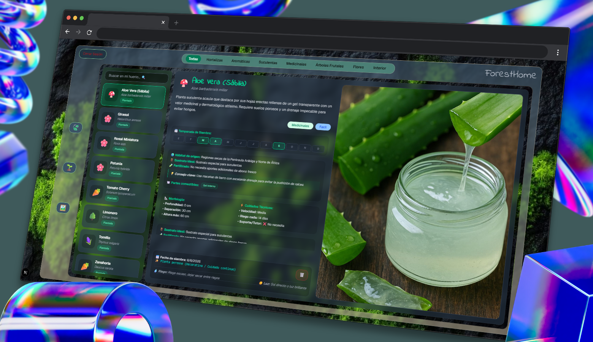

<div align="center">
  <h1>🌿 ForestHome</h1>
  <p>Aplicación Web Educativa e Interactiva de Botánica y Gestión de Huerto Urbano</p>

  <p>
    <a href="https://shllys.github.io/ForestHome/" target="_blank">
      
    </a>
    
  </p>
</div>

---

### 📋 Descripción del Proyecto

**ForestHome** es una plataforma web integral diseñada para amantes de las plantas y la jardinería urbana. El proyecto combina un catálogo botánico educativo categorizado con un sistema de gestión personalizada que permite a cada usuario registrado administrar su propio huerto, recibir alertas de cuidado, diagnosticar el estado de sus plantas y mantener un registro individual de sus publicaciones e imágenes.

---

### 📸 Vistas del Proyecto

<div align="center">
  
  <p><i>Catálogo botánico interactivo y panel de gestión del huerto.</i></p>
</div>

---

### 🛠️ Tecnologías Utilizadas

- **Frontend & Framework:** Next.js / React con TypeScript para un desarrollo robusto, modular y de alto rendimiento.
- **Enrutamiento:** App Router de Next.js para una navegación fluida entre el catálogo, los detalles de cada planta y el huerto privado.
- **Estilos & UI:** Tailwind CSS junto a componentes accesibles e íconos modernos para una interfaz limpia, responsiva y en modo oscuro.
- **Diseño UI/UX:** Prototipado y maquetado visual previo en Figma con una paleta temática botánica.
- **Backend como Servicio (BaaS) & Base de Datos:** Supabase (PostgreSQL, Auth y Storage), diseñado e implementado desde cero para la estructuración de tablas, políticas de privacidad, autenticación de usuarios y almacenamiento de archivos multimedia.

---

### 🚀 Características Principales

- **Catálogo y Clasificación por Categorías:** Organización estructurada de especies botánicas (medicinales, huerto, decoración, etc.) con filtros dinámicos e información técnica detallada.
- **Autenticación y Registro de Usuarios:** Inicio y gestión de sesión con persistencia de estado y protección de rutas privadas.
- **Huerto e Historial Personalizado:** Cada usuario cuenta con su propio espacio privado donde puede llevar un historial exclusivo de sus plantas, imágenes subidas y comentarios realizados.
- **Sistema de Alertas y Cuidados:** Recordatorios interactivos para acciones clave como riego, abonado, poda y recomendaciones de siembra.
- **Pestañas de Guía Especializada:** Secciones con tips de siembra, diagnóstico de hidratación, preparación de repelentes naturales y consejos de decoración.
- **Galería Interactiva y Comunidad:** Subida de imágenes personales a Supabase Storage con filtrado de autoría y participación en fichas comunitarias.

---

### 🗄️ Arquitectura de Backend y Base de Datos (Supabase / PostgreSQL)

Todo el esquema de base de datos fue modelado y estructurado de forma personalizada mediante la creación de tablas, columnas específicas y claves foráneas en Supabase:

- **Autenticación e Identidad (`auth.users`):** Control de acceso seguro y vinculación automática de registros a la ID única de cada usuario.
- **Catálogo de Plantas (`Plants`):** Tabla con columnas enriquecidas para especificaciones técnicas y tips de cuidado (`how_to_plant`, `health_tips`, `natural_repellents`, `decor_tips`, `category`).
- **Huerto Privado (`User_Garden`):** Relación N:M que asocia a cada usuario con sus plantas guardadas para el seguimiento individualizado de su cultivo.
- **Galería de Imágenes (`Gallery` / Supabase Storage):** Tabla y bucket para almacenar la URL, metadata e identificador del propietario de cada imagen subida.
- **Comentarios (`Comments`):** Registro de aportes y retroalimentación asociado de forma relacional al usuario y a la ficha de la planta correspondiente.

---

### 🔧 Instalación Local

Si deseas clonar este proyecto y ejecutarlo en tu entorno local, sigue estos pasos:

1. Clonar el repositorio:
   ```bash
   git clone [https://github.com/shllys/ForestHome.git](https://github.com/shllys/ForestHome.git)
   cd ForestHome
<<<<<<< HEAD
   ```
=======
>>>>>>> e5c0db98d3356798fd508f9ee8000aefa655aa7a
